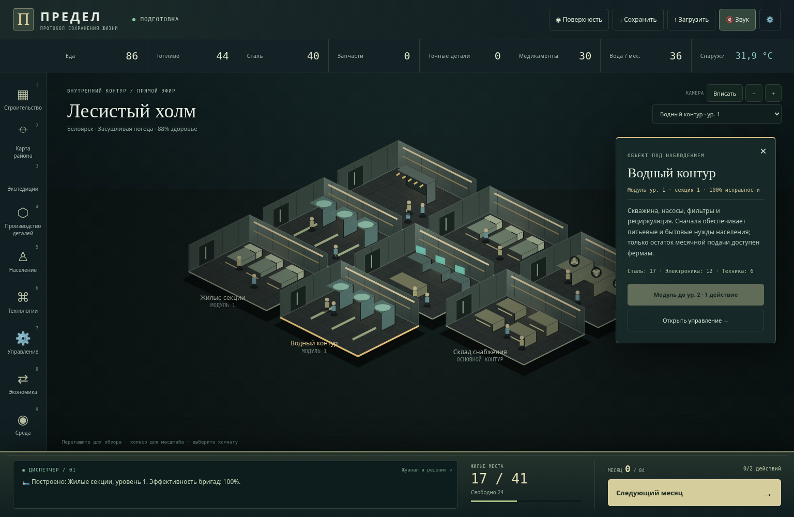

# ПРЕДЕЛ · shelter-protocol-84

Изометрический интерфейс V18 на модульном ядре существующей игры «ПРЕДЕЛ V17». Перенесены текущие правила, интерфейс, встроенная озвучка, анимированные панорамы, обмен и спасательные вылазки.

## Запуск

Нужен Node.js 22.12+ (проверено с 24.19.0).

```sh
npm ci
npm run dev
```

Vite выводит локальный адрес. Для проверки и сборки:

```sh
npm test
npm run build
```

Сборка проверяет TypeScript и создаёт `dist/Predel.html`: самостоятельную игру, которую можно открыть в браузере без сервера и интернета. `dist/index.html` и `dist/assets/` предназначены для обычного размещения на веб-сервере. Скрипт `npm run typecheck` проверяет типы отдельно.

## Сохранённые правила

- Существующие угрозы: ледниковый период, жара, ядерная катастрофа, эпидемия.
- Месяц 0 — выбор площадки; подготовка 0–18; обрушение 19–30; глубокий кризис 31–66; новая среда 67–84.
- 27 типов зданий и 18 существующих технологий. Знания открывают технологии автоматически.
- Строительство оплачивается и выполняется за действие по прежним правилам. Новые таймеры строительства, деревья из 30 технологий и замена угроз не добавлялись при переносе.
- Сохранён ключ `PREDEL_SAVE_V5`, импорт прежних JSON-сохранений, незавершённые события, входящие торговые предложения и остаток людей на пункте эвакуации.

Сохранения LocalStorage привязаны к происхождению страницы: при переходе с локального HTML на сервер или другой адрес используйте экспорт/импорт JSON. Браузеры могут по-разному хранить данные страниц `file://`.

## Разделение кода

- `src/config/`: здания, технологии, этапы, четыре исходных сценария и вспомогательные справочники. Эти JSON читаются работающей игрой.
- `src/core/TurnEngine.ts`: команды, единственное изменяемое состояние, отдельный RNG, уведомления и внедряемое хранилище. Запускается в Node.js без DOM, Canvas, аудио и браузерных заглушек.
- `src/core/State.ts`: контракты состояния и глубокие неизменяемые снимки для интерфейса.
- `src/core/SaveSystem.ts`: сериализация, валидация и атомарная загрузка. Функции выбора в живом событии восстанавливаются существующими обработчиками по названию и данным; функции не записываются в JSON.
- `src/systems/`: существующие формулы среды, жизнедеятельности, населения, строительства, инцидентов, обмена и экспедиций.
- `src/grid/`: неизменяемая проекция существующих установленных уровней модулей. Она не создаёт вторую модель мощностей и не меняет баланс.
- `src/visual/`: DOM-интерфейс, Canvas, камера, звук и браузерные загрузки. Визуальная случайность отделена от RNG симуляции.
- `src/assets/`: встроенные изображения, звуковые записи и проверяемый манифест ресурсов.

Интерфейс читает снимки и отправляет команды через `dispatch`; Canvas не может изменять население, запасы или результаты случайных событий. Основной экран показывает изометрические комнаты, оборудование и жителей. Камера поддерживает перемещение, масштабирование и выбор комнат; справа открываются состояние и модернизация. Базовые шесть комнат представляют существующие контуры исходного убежища и не дают дополнительных мощностей. После третьего уровня однотипные секции группируются на схеме, сохраняя суммарный уровень в инспекторе. Все игровые действия вызывают прежнее ядро через команды.

## API ядра

```ts
import { TurnEngine } from './src/core/TurnEngine';

const engine = new TurnEngine({ seed: 42 });
engine.subscribe(state => console.log(state.month));
engine.dispatch('startGame', ['heat', 40, 1]);
engine.dispatch('chooseSite', [0]);
engine.dispatch('nextMonth');
const json = engine.exportSave();
engine.loadSave(json);
```

Значения форм передаются третьим аргументом `dispatch`, например `tradeWant`, `tradeGive`, `tradeAmount`, `tradeTeam`. Симуляция не читает DOM. Для постоянного хранения передайте объект `StorageLike`; без него используется `MemoryStorage`.

## Границы переноса

Для сохранения поведения V17 внутренние формулы пока используют закрытый реестр `Runtime` и последовательность совместимых инициализаторов `SystemRegistry`. Это переходный слой с гибкой типизацией, а не публичный API. Он позволяет сохранить проверенные формулы и порядок прежних расширений без исполнения монолитного HTML. Внешний API, состояние, сохранения, события, сетка и камера типизированы отдельно. Разработчикам следует менять соответствующие файлы `systems/` и конфигурацию, а не добавлять новые обёртки в реестр.

Системная озвучка использует подсказки ударений. Произношение встроенных MP3 этим переносом не изменено и не сертифицировалось прослушиванием.

## Управление интерфейсом V18

Перетащите сцену для перемещения камеры; колесо и кнопки +/− меняют масштаб, «Вписать» показывает всё убежище. Нажмите на комнату или выберите её из списка секций. Клавиши 1–9 открывают соответствующий раздел, Escape закрывает панель; стрелки перемещают сфокусированную камеру, 0 возвращает общий вид.

На телефоне меню разделов прокручивается горизонтально над нижней панелью. Диспетчер открывает события и полный журнал. Кнопка следующего месяца при нерешённом событии открывает выбор решения. «Поверхность» сохраняет доступ к прежней анимированной панораме. Системная настройка уменьшения движения отключает непрерывную анимацию новой сцены; камера и расчёты продолжают работать.

Новый рисунок выполнен процедурно на Canvas2D: это стилизованная изометрия, без заимствованных спрайтов Fallout. Перемещение жителей и вентиляторы — визуальная анимация; расчёт труда остаётся в существующей модели населения.


